<picture><source media="(prefers-color-scheme: dark)" srcset="assets/header-dark.svg"><source media="(prefers-color-scheme: light)" srcset="assets/header-light.svg"></picture>

I like making things I can actually use and sometimes things that are just fun to build. Software engineering student at TU Dublin.

<samp><a href="https://port-regex.com">port-regex.com ↗</a> &nbsp;·&nbsp; <a href="https://outmatch.gg">outmatch.gg ↗</a> &nbsp;·&nbsp; <a href="https://github.com/RedregeX?tab=repositories">all repositories →</a></samp>

 

<picture><source media="(prefers-color-scheme: dark)" srcset="assets/section-01-dark.svg"><source media="(prefers-color-scheme: light)" srcset="assets/section-01-light.svg">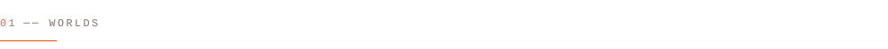</picture>

  <a href="https://outmatch.gg"><picture><source media="(prefers-color-scheme: dark)" srcset="assets/card-outmatch-dark.svg"><source media="(prefers-color-scheme: light)" srcset="assets/card-outmatch-light.svg">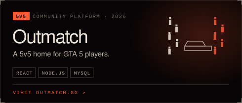</picture></a>
  <a href="https://port-regex.com"><picture><source media="(prefers-color-scheme: dark)" srcset="assets/card-port-regex-dark.svg"><source media="(prefers-color-scheme: light)" srcset="assets/card-port-regex-light.svg">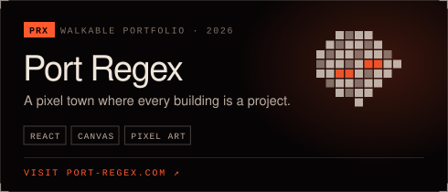</picture></a>
  <picture><source media="(prefers-color-scheme: dark)" srcset="assets/card-lyriks-dark.svg"><source media="(prefers-color-scheme: light)" srcset="assets/card-lyriks-light.svg">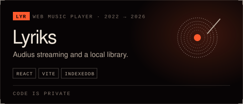</picture>
  <a href="#workbench"><picture><source media="(prefers-color-scheme: dark)" srcset="assets/card-workbench-dark.svg"><source media="(prefers-color-scheme: light)" srcset="assets/card-workbench-light.svg">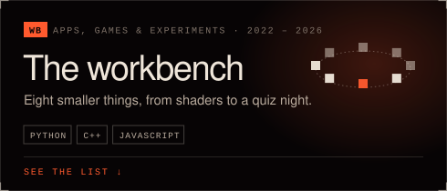</picture></a>

 

<picture><source media="(prefers-color-scheme: dark)" srcset="assets/section-02-dark.svg"><source media="(prefers-color-scheme: light)" srcset="assets/section-02-light.svg">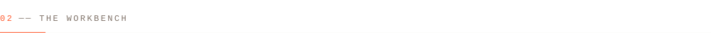</picture>

The smaller things I'm making. Some are useful, some were a chance to try something out.

| | Project | What it is | Built with | Year |
|:--|:--|:--|:--|--:|
| <samp>AST</samp> | [**Aster**](https://github.com/RedregeX/Aster_Python_v0.1) | A small universe you can fly through | Python · ModernGL · GLSL | <samp>2026</samp> |
| <samp>SOC</samp> | [**Social**](https://github.com/RedregeX/SocialNetwork) | A small social network that actually works | React · Node.js · SQLite | <samp>2026</samp> |
| <samp>?&#36;?</samp> | [**The Weakest Link**](https://github.com/RedregeX/SlaboeZveno) | A team quiz night on one shared screen | React · Vite | <samp>2026</samp> |
| <samp>X&gt;</samp> | [**X Autoplay**](https://github.com/RedregeX/X-autoplay) | TikTok-style autoplay for videos on X | Chrome extension · MV3 | <samp>2026</samp> |
| <samp>AU</samp> | [**Gold Corporation**](https://github.com/RedregeX/Organisation-website) | A landing page for a fictional company | HTML · CSS · JavaScript | <samp>2025</samp> |
| <samp>360</samp> | [**Scroll sequence**](https://github.com/RedregeX/Full-3dweb) | Scroll down, the object spins | GSAP · ScrollTrigger · Canvas | <samp>2023</samp> |
| <samp>C++</samp> | [**2D game in C++**](https://github.com/RedregeX/2d-game) | A tiny game engine, written from scratch | C++ · SFML | <samp>2022</samp> |
| <samp>SIV</samp> | [**Sieve of Eratosthenes**](https://github.com/RedregeX/eratosfen) | Primes, crossed off one multiple at a time | C++ · CMake | <samp>2022</samp> |

 

<picture><source media="(prefers-color-scheme: dark)" srcset="assets/section-03-dark.svg"><source media="(prefers-color-scheme: light)" srcset="assets/section-03-light.svg">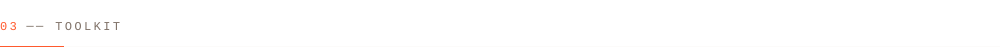</picture>

Open a drawer. Each tile leads to its docs.

  
<samp><b>01</b> &nbsp;─&nbsp; <b>Web</b></samp> JavaScript / React / Node.js / Django / HTML / CSS

   
  
<samp>INTERFACES</samp>

  

    <a href="https://developer.mozilla.org/en-US/docs/Web/JavaScript" title="JavaScript documentation"><picture><source media="(prefers-color-scheme: dark)" srcset="assets/javascript-dark.svg"><source media="(prefers-color-scheme: light)" srcset="assets/javascript-light.svg">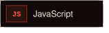</picture></a>
    <a href="https://react.dev/" title="React documentation"><picture><source media="(prefers-color-scheme: dark)" srcset="assets/react-dark.svg"><source media="(prefers-color-scheme: light)" srcset="assets/react-light.svg">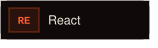</picture></a>
    <a href="https://developer.mozilla.org/en-US/docs/Web/HTML" title="HTML documentation"><picture><source media="(prefers-color-scheme: dark)" srcset="assets/html-dark.svg"><source media="(prefers-color-scheme: light)" srcset="assets/html-light.svg">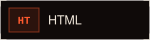</picture></a>
    <a href="https://developer.mozilla.org/en-US/docs/Web/CSS" title="CSS documentation"><picture><source media="(prefers-color-scheme: dark)" srcset="assets/css-dark.svg"><source media="(prefers-color-scheme: light)" srcset="assets/css-light.svg">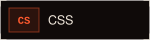</picture></a>
  

  
<samp>SERVERS</samp>

  

    <a href="https://nodejs.org/en/learn" title="Node.js documentation"><picture><source media="(prefers-color-scheme: dark)" srcset="assets/node-dark.svg"><source media="(prefers-color-scheme: light)" srcset="assets/node-light.svg"></picture></a>
    <a href="https://docs.djangoproject.com/" title="Django documentation"><picture><source media="(prefers-color-scheme: dark)" srcset="assets/django-dark.svg"><source media="(prefers-color-scheme: light)" srcset="assets/django-light.svg">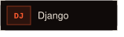</picture></a>
  

  
<samp><b>02</b> &nbsp;─&nbsp; <b>Apps, games &amp; hardware</b></samp> Python / C++ / C# / Android / React Native / Unreal Engine / Arduino

   
  
<samp>LANGUAGES</samp>

  

    <a href="https://docs.python.org/3/" title="Python documentation"><picture><source media="(prefers-color-scheme: dark)" srcset="assets/python-dark.svg"><source media="(prefers-color-scheme: light)" srcset="assets/python-light.svg">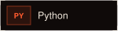</picture></a>
    <a href="https://isocpp.org/" title="C++ documentation"><picture><source media="(prefers-color-scheme: dark)" srcset="assets/cpp-dark.svg"><source media="(prefers-color-scheme: light)" srcset="assets/cpp-light.svg">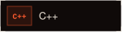</picture></a>
    <a href="https://learn.microsoft.com/en-us/dotnet/csharp/" title="C# documentation"><picture><source media="(prefers-color-scheme: dark)" srcset="assets/csharp-dark.svg"><source media="(prefers-color-scheme: light)" srcset="assets/csharp-light.svg"></picture></a>
  

  
<samp>MOBILE</samp>

  

    <a href="https://developer.android.com/" title="Android documentation"><picture><source media="(prefers-color-scheme: dark)" srcset="assets/android-dark.svg"><source media="(prefers-color-scheme: light)" srcset="assets/android-light.svg">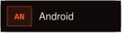</picture></a>
    <a href="https://reactnative.dev/" title="React Native documentation"><picture><source media="(prefers-color-scheme: dark)" srcset="assets/react-native-dark.svg"><source media="(prefers-color-scheme: light)" srcset="assets/react-native-light.svg">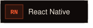</picture></a>
  

  
<samp>GAMES &AMP; HARDWARE</samp>

  

    <a href="https://dev.epicgames.com/documentation/en-us/unreal-engine" title="Unreal Engine documentation"><picture><source media="(prefers-color-scheme: dark)" srcset="assets/unreal-dark.svg"><source media="(prefers-color-scheme: light)" srcset="assets/unreal-light.svg">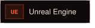</picture></a>
    <a href="https://docs.arduino.cc/" title="Arduino documentation"><picture><source media="(prefers-color-scheme: dark)" srcset="assets/arduino-dark.svg"><source media="(prefers-color-scheme: light)" srcset="assets/arduino-light.svg"></picture></a>
  

  
<samp><b>03</b> &nbsp;─&nbsp; <b>Day to day</b></samp> Git / Linux

   
  

    <a href="https://git-scm.com/doc" title="Git documentation"><picture><source media="(prefers-color-scheme: dark)" srcset="assets/git-dark.svg"><source media="(prefers-color-scheme: light)" srcset="assets/git-light.svg">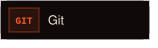</picture></a>
    <a href="https://www.linux.org/" title="Linux documentation"><picture><source media="(prefers-color-scheme: dark)" srcset="assets/linux-dark.svg"><source media="(prefers-color-scheme: light)" srcset="assets/linux-light.svg">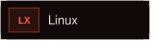</picture></a>
  

 

<a href="https://github.com/RedregeX?tab=repositories"><picture><source media="(prefers-color-scheme: dark)" srcset="assets/footer-dark.svg"><source media="(prefers-color-scheme: light)" srcset="assets/footer-light.svg"></picture></a>
